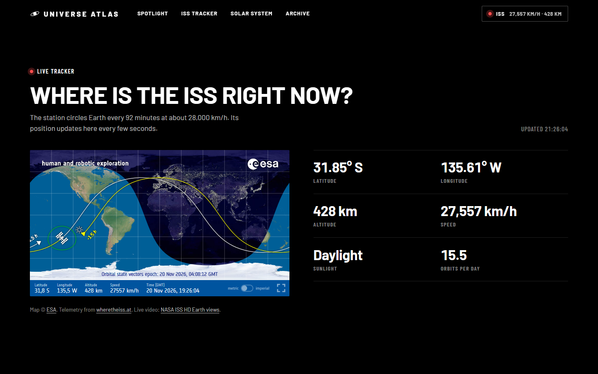
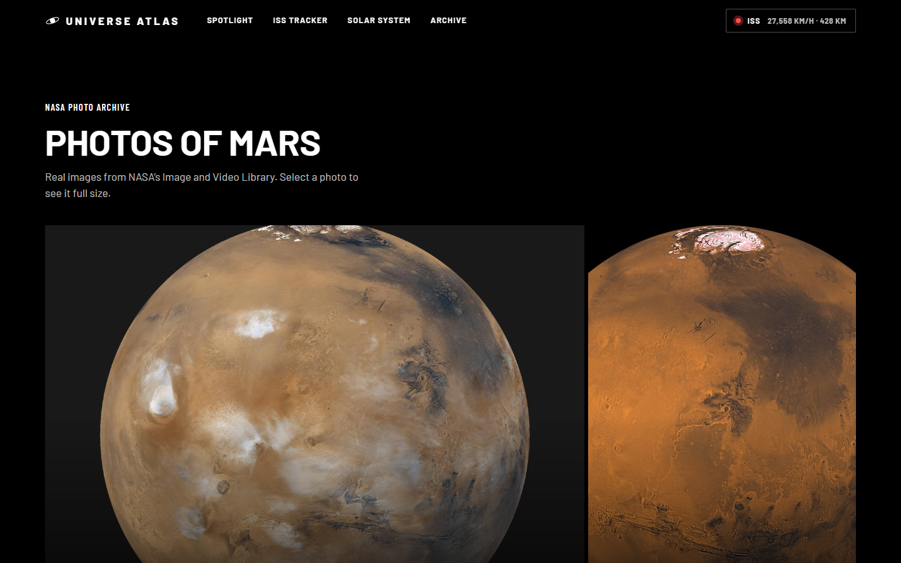

# Universe Atlas

**Watch Earth live from the International Space Station, see where the station is right now, and explore the solar system through NASA's own photos.**

**[Open the live site →](https://nasa-api-solar-system.gagianohenry.workers.dev/)**

<p align="center">
  
</p>

Universe Atlas is a single-page, full-screen space explorer built with plain HTML, CSS and JavaScript. There's no framework and no build step. It pulls everything live from public NASA and ESA sources.

## What you can do

| Section | What it is |
| --- | --- |
| **Live from the ISS** | The opening screen plays NASA's official live HD camera feed from the space station. Turn on the sound or go fullscreen. The feed is shown exactly as NASA sends it; on Earth's night side it goes dark and the label says so. |
| **Spotlight** | NASA's Astronomy Picture of the Day, full-screen. If the APOD service is busy, it falls back to one of several iconic high-resolution NASA images. |
| **ISS tracker** | ESA's live ground-track map beside live position, altitude, speed and sunlight data, refreshed every few seconds. The header shows the station's speed and altitude wherever you are on the page. |
| **Solar system** | A top-down view of all eight planets in order from the Sun, each shown with a real NASA photograph and lit from the Sun so it shows its phase as it orbits. Each is labelled with its number and distance in AU, and they orbit at their relative speeds, so Mercury races and Neptune crawls. Select a planet to fly in for a close-up (with its diameter, day and year), then press Esc or **Back to solar system** to zoom out. Deep-sky objects like Andromeda load their photos too. |
| **Photo archive** | Real images from the NASA Image and Video Library for whatever you selected, ranked for relevance, de-duplicated, and served sharp on any screen. Open any photo full size and step through them with the arrow keys. |

<p align="center">
  
  
</p>

## Data sources and freshness

Everything below is fetched by the visitor's browser at page load; there is no backend and no server-side cache. All endpoints were **last verified on 21 November 2026** with the contract tests (`npm run test:contract`), which also run daily in GitHub Actions.

| Source | Endpoint | Refreshed | Cached? |
| --- | --- | --- | --- |
| NASA ISS HD Earth views (YouTube) | `youtube-nocookie.com/embed/ROboUHfPUrU` | Live video | No |
| ESA ISS tracker | `isstracker.spaceflight.esa.int` (embedded widget) | Live, by ESA's own page | No |
| [wheretheiss.at](https://wheretheiss.at/) v1 | `api.wheretheiss.at/v1/satellites/25544` | Every 5 s while the tracker is on screen; once a minute otherwise, for the header | No |
| NASA APOD | `api.nasa.gov/planetary/apod` | Once per page load (NASA publishes one image a day) | No |
| NASA Image and Video Library | `images-api.nasa.gov/search` | On each destination selected and each *Load more* | Browser only: NASA sends `max-age=300` |

What is **not** live:
- **Planet photos** in `assets/planets/` are NASA images downloaded and cropped once (IDs under Credits). They don't change unless regenerated.
- **Planet facts and distances** (diameter, day, year, AU) are rounded reference values written into `app.js`, not fetched. Moon counts are deliberately left out because they keep changing.
- **Orbit positions** are illustrative: correct order, relative distances (compressed) and relative speeds, but not computed from real ephemerides, so a planet's position on screen is not where it is in the sky today.

**Known limitation:** APOD uses NASA's shared `DEMO_KEY`, which is often rate-limited (HTTP 429) or down (5xx). The site then shows one of several high-resolution archive images instead, and visitors can paste their own free key from [api.nasa.gov](https://api.nasa.gov/) under the spotlight.

## Details worth knowing

- **Sharp images everywhere.** Each photo gets a `srcset` built from NASA's own width data, so phones download small files and retina or 4K screens get large ones. Images NASA only has at low resolution are left out.
- **Realistic bodies.** Each planet and the Moon is a NASA full-disk photo, cropped to the disk and stored at 160&nbsp;px (about 70&nbsp;KB for all nine). A shading layer turns every frame to face the Sun, and Saturn keeps its photographed rings. The Sun is drawn with limb darkening and a slowly turning granulation texture.
- **Smooth zoom.** Selecting a planet flies the camera in. The planet travels in a straight line to its spot on screen while the zoom eases in logarithmically, then the camera locks onto the moving planet. Sharper 480&nbsp;px photos load only once a planet fills the view.
- **Readable orbits.** Orbit spacing blends even steps with the square root of real distance. Inner planets bunch up and outer ones spread out, as in reality, but every ring stays clickable. Speeds follow Kepler's third law, slowed so the outer planets still visibly move.
- **Light on resources.** The muted live video pauses when scrolled away, and ISS data is only fetched while the tracker is on screen.
- **Accessible.** It works with the keyboard, respects reduced-motion settings, and includes a skip link.

## Run locally

```bash
npm start
```

Then open [http://127.0.0.1:3000](http://127.0.0.1:3000).

## Tests

End-to-end tests use [Playwright](https://playwright.dev/) and run on desktop Chrome and an emulated Pixel 7. Every external service (NASA APIs, ISS telemetry, YouTube, ESA) is replaced with fixture data in `tests/fixtures.js`, so results are the same every run.

```bash
npm install
npx playwright install chromium   # first time only
npm test                          # tests a local server
npm run test:live                 # tests the deployed site
npm run test:contract             # calls the real APIs (CONTRACT=1 required)
npm run test:ui                   # interactive runner
npm run test:report               # open the last HTML report
```

GitHub Actions runs the suite on every push and pull request (`.github/workflows/tests.yml`). A daily job (`live-check.yml`) tests the deployed site; if it fails it opens an issue labelled `live-site-failure`, and closes it automatically once the site passes again.

| Spec | Covers |
| --- | --- |
| `smoke.spec.js` | Page loads with no script errors, no sideways scrolling, nav links, skip link, versioned assets |
| `hero.spec.js` | Muted live ISS stream, calls to action, night-side mode, Sound control only when playing |
| `iss.spec.js` | Telemetry formatting, header chip, polling only while visible, ESA map scaling |
| `spotlight.spec.js` | APOD, archive fallback when APOD fails, unsafe video URLs rejected |
| `solar-system.spec.js` | Planet order and distances, textures, relative speeds, click-to-zoom, zoom-out controls, facts, frame rate |
| `gallery.spec.js` | Relevance filtering, de-duplication, Load more, full-size viewer with arrow keys |
| `images.spec.js` | No photo drawn larger than its file allows; every planet texture exists |
| `dev-server.spec.js` | Local server rejects paths outside the project and survives malformed URLs |
| `contract.spec.js` | **Real** NASA, wheretheiss.at, YouTube and ESA endpoints still answer with the fields the site uses (not mocked; daily in CI) |

The mocked tests prove the UI handles each response correctly; the contract tests prove the real services still send those responses.

## Deploy

The site is deployed as a **Cloudflare Worker serving static assets** (`wrangler.jsonc`). It's connected to this repository, so every push to `main` deploys automatically.

- `.assetsignore` keeps local tooling (`server.mjs`, `wrangler.jsonc`, `.git`, …) out of the published site.
- `_headers` sets security headers and makes browsers revalidate CSS and JS on each visit, so a new deploy is never mixed with stale cached files.

## Project structure

```text
.
|-- index.html          # Page structure and copy
|-- styles.css          # Full-screen layout, typography, responsive rules
|-- app.js              # Live stream, ISS tracker, solar system, NASA galleries
|-- server.mjs          # Tiny static server for local development
|-- capture-preview.mjs # Headless-Chrome screenshots for this README
|-- tests/              # Playwright end-to-end tests
|-- playwright.config.js / playwright.live.config.js
|-- wrangler.jsonc      # Cloudflare Worker config
|-- _headers            # Response headers on Cloudflare
|-- .assetsignore       # Files kept out of the deployed site
|-- assets/planets/     # Cropped NASA photos of each planet and the Moon
|-- preview.png         # README and link-preview image
`-- docs/               # Additional README screenshots
```

To refresh the screenshots, run the local server and then:

```bash
node capture-preview.mjs http://127.0.0.1:3000 preview.png "#atlas"
```

## What I learned building this

**Live data is never as clean as the docs.**
- NASA's ISS camera feed is dark for about a third of every 92-minute orbit and sometimes shows a "loss of signal" card. YouTube gives the embedding page no way to detect that card, so I couldn't hide it. I made the headline readable over anything instead, and labelled the night side rather than masking it.
- APOD's shared `DEMO_KEY` regularly returns 429 or 500. Every API call has a fallback path, and the contract test treats those statuses as warnings, not failures.

**Bugs I hit and fixed:**
- *A filter that dropped half the Earth photos.* Images were excluded if their text contained "iss" (to skip station interiors). As a substring that matched every "m**iss**ion". I switched to whole-word matching.
- *Blurry photos on good screens.* Some NASA results only exist as small thumbnails, and they were stretched 3–4× into large tiles. I now build `srcset` from the width NASA reports for each rendition, drop images under 640 px, and reserve the large tiles for high-resolution sources. A test fails if any photo is drawn larger than its file.
- *A deploy that looked broken for returning visitors.* A one-hour CSS/JS cache meant a new HTML page could load with old styles. I fixed it with `Cache-Control: no-cache` plus versioned asset URLs.
- *A fix that caused a regression.* Stopping the orbits from jumping on every selection (#1) made them run behind the info card on desktop (#12), because the space was then measured once, before the card's facts rendered. The fix and a test for each case are in #9 and #16.
- *A third-party widget that can't be resized.* ESA's tracker renders at a fixed 625 px and leaves white edges when stretched. It's shown at native size and only ever scaled down, so it stays sharp.

**How I handle errors:**
- **The page never depends on one service.** APOD falls back to curated archive images, the hero falls back to a still image if the stream fails or ends, and the gallery shows a clear message.
- **Polling backs off.** The ISS tracker doubles its delay after each failure (capped at 60 s) and stops entirely while it's off screen or the tab is hidden.
- **Untrusted input is validated.** APOD video URLs must be `http(s)`, and all API text is escaped before it reaches the page.
- **Problems become issues.** A daily GitHub Action tests the live site and the real APIs, and opens an issue when either fails. Code reviews file their findings as issues and fix them in pull requests.

## Credits

Imagery and video courtesy of NASA. Planet photos: NASA/JPL (PIA15162 Mercury, PIA00104 Venus, PIA18033 Earth, PIA00407 Mars, PIA00343 Jupiter, PIA05389 Saturn, PIA18182 Uranus, PIA01492 Neptune) and NASA/Goddard (Full Moon). ISS map © ESA. This is an independent project, not affiliated with NASA, ESA or SpaceX.

## License

[MIT](./LICENSE)
